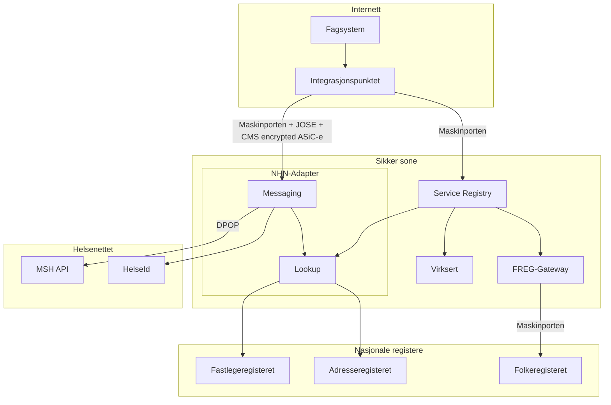
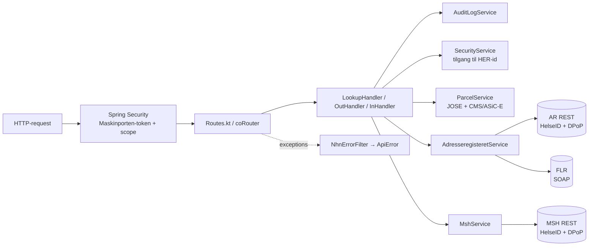
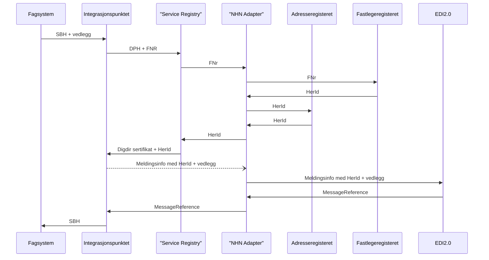
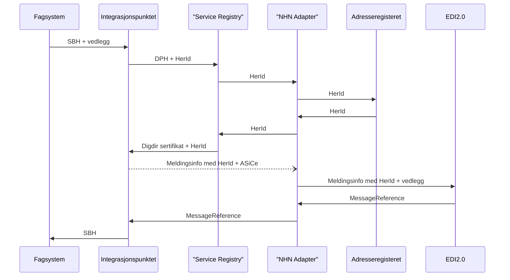
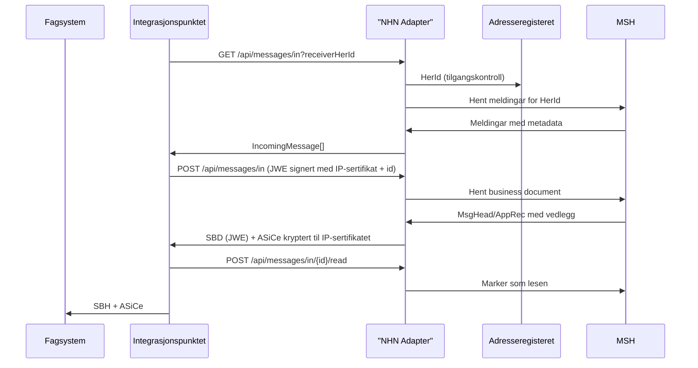

# efm-nhn-adapter

[](https://github.com/felleslosninger/efm-nhn-adapter/actions/workflows/coverage-badge.yml)

efm-nhn-adapter er eit adapter for sending og mottak av meldingar via Norsk Helsenett si meldingsteneste (DPH) frå
[eFormidling](https://github.com/felleslosninger/efm-integrasjonspunkt). Integrasjonspunktet snakkar med adapteret over
eit REST-API sikra med Maskinporten, og adapteret snakkar vidare med NHN sine tenester på vegner av klienten.

Adapteret:

- slår opp mottakarar i Adresseregisteret (AR), anten direkte på HER-id eller via fastlegen til ein pasient (fødselsnummer
  → Fastlegeregisteret → HER-id)
- sender dialogmeldingar og applikasjonskvitteringar til NHN sitt Message Service Handler-API (MSH)
- hentar innkomne meldingar og kvitteringar frå MSH og leverer dei kryptert tilbake til integrasjonspunktet
- autentiserer seg mot NHN med HelseID (DPoP), med single- eller multi-tenant-token avhengig av klienten
- sjekkar at klienten har lov til å handle på vegner av organisasjonen som eig HER-id-en
- skriv auditlogg for alle API-kall

Integrasjonane mot NHN går gjennom bibliotek frå KS Digital (`no.ks.fiks:msh-client` og `no.ks.fiks:helseid-client`).

## Innhald

- [Teknologi](#teknologi)
- [Modular](#modular)
- [Arkitektur](#arkitektur)
- [API](#api)
- [Kom i gang](#kom-i-gang)
- [Konfigurasjon](#konfigurasjon)
- [Testing](#testing)
- [Kodestil](#kodestil)
- [Vanlege endringar](#vanlege-endringar)
- [Bygg, release og utrulling](#bygg-release-og-utrulling)
- [Drift og overvaking](#drift-og-overvaking)
- [Caser](#caser)

## Teknologi

- Kotlin 2.4 på Java 25 (`nhn-model` vert kompilert for Java 21 slik at integrasjonspunktet kan bruke det)
- Spring Boot 4.1 med WebFlux, funksjonelle ruter (`coRouter`) og Kotlin coroutines
- Spring Security som OAuth2 resource server (Maskinporten-token)
- kotlinx.serialization for API-modellen, Jackson for `StandardBusinessDocument`
- [move-common](https://github.com/felleslosninger/efm-common) for JOSE, CMS og ASiC-E (dokumentpakking)
- Kotest, MockK, springmockk og WireMock for testar
- Maven (med Maven Wrapper), Spotless/ktfmt for formatering, JaCoCo for testdekning

## Modular

| Modul                                  | Innhald                                                                                                                                                                    |
|----------------------------------------|----------------------------------------------------------------------------------------------------------------------------------------------------------------------------|
| [`nhn-model`](nhn-model)               | Transportmodellen i API-et (`ArDetails`, `IncomingMessage`, `MessageStatus`, `ApiError`, multipart-namn osv.) og XML-serialisering av dialogmelding og AppRec. Vert publisert som eige bibliotek og brukt av integrasjonspunktet. |
| [`nhn-adapter-app`](nhn-adapter-app)   | Sjølve Spring Boot-applikasjonen.                                                                                                                                          |

Endringar i `nhn-model` påverkar integrasjonspunktet. Hald dei bakoverkompatible, eller koordiner med
integrasjonspunktet.

### Pakkar i `nhn-adapter-app`

Alle pakkane ligg under `no.difi.meldingsutveksling.nhn.adapter`.

| Pakke / fil                       | Ansvar                                                                                                         |
|-----------------------------------|----------------------------------------------------------------------------------------------------------------|
| `Routes.kt`                       | URL-ane (`ApiPaths`) og kva handlar-metode kvar rute kallar.                                                   |
| `RoutesConfiguration.kt`          | Lagar `RouterFunction`-bønna og dokumenterer rutene for springdoc (`@RouterOperations`).                       |
| `BeanRegistration.kt`             | Registrerer alle bønner i applikasjonen eksplisitt (`BeanRegistrarDsl`). Sjå [Bønner](#bønner).                |
| `NhnErrorFilter.kt`               | Gjer om exceptions til `ApiError`-svar med rett HTTP-status.                                                   |
| `ApiExamples.kt`                  | Eksempel brukt i OpenAPI-dokumentasjonen.                                                                      |
| `handlers`                        | `LookupHandler`, `OutHandler` og `InHandler` (eitt sett endepunkt kvar), `ParcelService` (JOSE/CMS/ASiC-E) og `DialogmeldingDefaults`. |
| `integration.adresseregisteret`   | `AdresseregisteretService`: oppslag i AR og Fastlegeregisteret, og omsetjing av feil derifrå.                  |
| `integration.msh`                 | `MshService` mot MSH, og mapping mellom `StandardBusinessDocument` og NHN sine XML-format (MsgHead, AppRec).   |
| `integration.IntegrationBeans`    | Opprettar klientane frå KS Fiks-biblioteka (AR, FLR, MSH, HelseID).                                            |
| `security`                        | Spring Security-oppsett, `ClientContext` (claims frå Maskinporten-tokenet) og tilgangskontroll (`SecurityService`). |
| `audit`                           | Auditlogging av API-kall og pseudonymisering av fødselsnummer i auditloggen (`IdentifierPseudonymizer`).       |
| `logging`                         | Maskering av fødselsnummer i applikasjonsloggen (`FnrMaskingLogstashEncoder`).                                 |
| `messages`                        | Forretningsmeldingane som ligg i SBD-en (`dialogmelding`, `dialogmelding_kvittering`).                         |
| `config`                          | Konfigurasjonsklassar og codec-/Jackson-oppsett.                                                               |
| `extensions`                      | Kotlin extension-funksjonar for request, response, SBD, sertifikat osv.                                        |
| `errors`                          | Eigne exceptions.                                                                                              |

## Arkitektur

### Systemskisse



### Flyten gjennom applikasjonen



Kvar handlar-metode følgjer same mønster:

1. Lag ein auditlogg-oppføring med `NHNAdapterAuditIdentifier.<OPERASJON>.entry(clientContext)` og køyr resten inne i
   `auditLogService.log(...)`, som loggar om kallet gjekk bra eller ikkje.
2. Dekrypter og verifiser innhaldet med `ParcelService` (der det er relevant).
3. Sjekk tilgang med `SecurityService.assertAccessToHerId(...)`.
4. Kall NHN via `MshService` / `AdresseregisteretService`.
5. Returner svaret. Exceptions vert ikkje fanga i handlarane, men omsett av `NhnErrorFilter`.

Blokkerande kall (AR og FLR, kryptering og ASiC-handsaming) vert køyrde på `Dispatchers.IO`.

### Bønner

Applikasjonen brukar ikkje komponentskanning for sine eigne klassar. Handlarar, tenester og klientar er vanlege
Kotlin-klassar utan annotasjonar, og alle vert registrerte i [`BeanRegistration.kt`](nhn-adapter-app/src/main/kotlin/no/difi/meldingsutveksling/nhn/adapter/BeanRegistration.kt),
gruppert i `properties()`, `security()`, `integrations()`, `services()`, `handlers()` og `openApi()`. Konfigurasjon vert
bunden til data-klassane i `config/ConfigurationProperties.kt` med `env.bindRequired("<prefix>")`, slik at
applikasjonen feilar ved oppstart om noko manglar.

Unntaket er `@Configuration`-klassane i `config/` og `RoutesConfiguration`. Bønnene som `ParcelService` treng frå
move-common (`VerifyJWT`, `AsicParser`, `DecryptCMSDocument`, `CreateCMSEncryptedAsice`) kjem frå autokonfigurasjonen
i det biblioteket.

### Sikkerheit og tilgangskontroll

- Alle kall til `/api/**` krev eit Maskinporten-token med scope `eformidling:dph`. Tokenet må vere utferda av ein av
  `security.trusted-issuers`.
- `ClientContext` hentar `client_id`, `consumer`, `supplier`, `delegation_source` og `scope` frå tokenet.
- Før adapteret les eller sender meldingar for ein HER-id, slår `SecurityService` opp HER-id-en i AR og sjekkar at
  `consumer` i tokenet er organisasjonen som eig han (forelderen i AR). Får klienten ikkje tilgang, vert svaret `403`.
- Ein leverandør (`supplier`) som handlar på vegner av ein annan organisasjon må ha ein delegering frå
  `security.delegation-source` (Altinn).
- Mot MSH vert det henta HelseID-token for `consumer`-organisasjonen: multi-tenant når tokenet har `supplier`, elles
  single-tenant.

### Meldingsformat og kryptering

Meldingane mellom integrasjonspunktet og adapteret har to delar (multipart):

| Del                  | Format                                                                                                                                               |
|----------------------|------------------------------------------------------------------------------------------------------------------------------------------------------|
| `forretningsmelding` | `application/jose`: ein JWE kryptert til mottakaren sitt sertifikat, som inneheld ein JWS (PS256) med ein `StandardBusinessDocument` (SBD) som JSON. Signeringssertifikatet ligg i `x5c`-headeren. |
| `dokumentpakke`      | `application/vnd.etsi.asic-e+zip`: CMS-kryptert ASiC-E med hovuddokumentet (dialogmelding-XML) og vedlegg.                                           |

Adapteret brukar nøkkellageret i `keystore.*` til å dekryptere det som kjem inn og signere det som går ut. Oppslaget
(`/api/lookup`) returnerer adapteret sitt sertifikat i `derCertificate`, slik at integrasjonspunktet kan kryptere til
det. Ved henting av innkomne meldingar krypterer adapteret svaret til sertifikatet integrasjonspunktet signerte
førespurnaden med. `certificate.mode` (`TEST`, `PRODUCTION` eller `SELF_SIGNED`) styrer kva sertifikat som vert godtekne
ved verifisering.

Støtta meldingstypar (`BusinessMessageType`):

| Type                       | Innhald                                                                                           |
|----------------------------|---------------------------------------------------------------------------------------------------|
| `dialogmelding`            | Namnet på hovuddokumentet i dokumentpakken, pasient og metadata for vedlegg. Vert sendt som MsgHead til MSH. |
| `dialogmelding_kvittering` | Applikasjonskvittering (AppRec) med status `OK`, `REJECTED` eller `OK_ERROR_IN_MESSAGE_PART`.    |

## API

Alle stiar ligg under kontekststien `/nhn-adapter`. Ein køyrande instans har Swagger UI på
`/nhn-adapter/swagger-ui.html` (lokalt <http://localhost:8082/nhn-adapter/swagger-ui.html>) og OpenAPI-spesifikasjonen
på `/nhn-adapter/v3/api-docs`. Begge er opne utan token.

| Metode | Sti                                         | Request                                         | Respons                         | Beskriving                                                                                     |
|--------|---------------------------------------------|-------------------------------------------------|---------------------------------|------------------------------------------------------------------------------------------------|
| GET    | `/api/lookup/{identifier}`                  | –                                               | `application/json` `ArDetails`  | Slår opp `her-id:<HER-id>` eller `fastlege-for:<fødselsnummer>` i AR. Ukjend HER-id gir `404`. |
| POST   | `/api/messages/out`                         | `multipart/form-data` (`forretningsmelding`, `dokumentpakke`) | `text/plain` meldingsreferanse | Sender ei dialogmelding eller ein kvittering. `dokumentpakke` trengst berre for dialogmelding. |
| GET    | `/api/messages/out/{messageId}/statuses`    | –                                               | `application/json` `MessageStatus[]` | Transport- og kvitteringsstatus for ei utgåande melding.                                 |
| GET    | `/api/messages/in?receiverHerId=<HER-id>`   | –                                               | `application/json` `IncomingMessage[]` | Lister innkomne meldingar for ein HER-id.                                              |
| POST   | `/api/messages/in`                          | `application/jose` (JWE med `{"id": "<id>"}`)   | `multipart/mixed` (`forretningsmelding`, ev. `dokumentpakke`) | Hentar ei innkomen melding, kryptert til klienten. |
| POST   | `/api/messages/in/{messageId}/read?receiverHerId=<HER-id>` | –                                | `text/plain`                    | Markerer ei innkomen melding som lesen i MSH.                                                  |

### Feil

Alle feil vert returnerte som `ApiError` (JSON) av `NhnErrorFilter`, med `timestamp` på ISO-8601-format i UTC:

| Exception                                                                | Status         |
|--------------------------------------------------------------------------|----------------|
| `HerIdNotFoundException` på oppslag                                      | 404            |
| `HerIdNotFoundException` elles, `IllegalArgumentException`, `DialogmeldingNotFoundException`, `ApplicationReceiptException` | 400 |
| `AccessDeniedException`                                                  | 403            |
| Feil frå AR (`E7778`) eller FLR (`E7779`)                                | 502            |
| 4xx frå MSH, unnateke 401 og 403                                         | same status og melding som MSH gav |
| Anna feil frå MSH (`E7780`), til dømes 401, 403 og 5xx                   | 502            |
| Alt anna (`E7777`)                                                       | 500            |

## Kom i gang

### Føresetnader

- JDK 25
- Tilgang til GitHub Packages for `felleslosninger`. Avhengigheiter som move-common vert henta derifrå, så du treng eit
  [personal access token](https://github.com/settings/tokens) med `read:packages` i `~/.m2/settings.xml`:

  ```xml
  <settings>
    <servers>
      <server>
        <id>github</id>
        <username>DITT_GITHUB_BRUKARNAMN</username>
        <password>DITT_TOKEN</password>
      </server>
    </servers>
  </settings>
  ```

Maven treng du ikkje installere; bruk `./mvnw` (eller `mvnw.cmd` på Windows).

### Bygg og test

Bygg alt og køyr alle testar (einingstestar, integrasjonstestar og formateringssjekk):

```bash
./mvnw verify
```

Bygg utan testar:

```bash
./mvnw verify -DskipTests
```

Køyr éin testklasse:

```bash
./mvnw -pl nhn-adapter-app -am test -Dtest=SecurityServiceTest -Dsurefire.failIfNoSpecifiedTests=false
```

### Git-hook

[`.githooks/pre-commit`](.githooks/pre-commit) formaterer Kotlin-filene som er med i commiten, med Spotless, før kvar
commit. Han er ikkje aktiv før du slår han på:

```bash
git config core.hooksPath .githooks
```

### Køyre lokalt

Applikasjonen treng ekte tilgang til NHN sine testmiljø: brukarnamn og passord for AR/FLR, ein HelseID-klient
(klient-id og privat nøkkel som JWK) og eit nøkkellager med eit virksomheitssertifikat. Få desse frå teamet.

Lag `nhn-adapter-app/src/main/resources/application-local.yml`. Fila står i `.gitignore` og skal aldri sjekkast inn.

```yaml
spring:
  application:
    environment: 'local'

server:
  port: 8082

management:
  server:
    port: 9090

nhn:
  services:
    ar:
      url: "https://cpapi.test.grunndata.nhn.no"
    flr:
      url: "https://ws-web.test.nhn.no/v2/flr"
      username: "<brukarnamn>"
      password: "<passord>"
    msh:
      url: "https://api.tjener.test.melding.nhn.no"

keystore:
  alias: "<alias>"
  password: "<passord>"
  path: "file:<sti til nøkkellager>.jks"

oauth2:
  helse-id:
    issuer: "https://helseid-sts.test.nhn.no"
    audience: "https://helseid-sts.test.nhn.no"
    client-id: "<HelseID klient-id>"
    private-key: >
      <privat nøkkel som JWK (JSON)>

security:
  delegation-source: "https://tt02.altinn.no/"
  trusted-issuers:
    - "https://test.maskinporten.no/"

certificate:
  mode: TEST
```

Start så applikasjonen med profilen `local`, anten ved å køyre `main` i
[`Main.kt`](nhn-adapter-app/src/main/kotlin/no/difi/meldingsutveksling/nhn/adapter/Main.kt) frå IntelliJ med
`spring.profiles.active=local`, eller frå kommandolinja:

```bash
./mvnw install -DskipTests
```

```bash
./mvnw -pl nhn-adapter-app spring-boot:run -Dspring-boot.run.profiles=local
```

API-et svarar då på <http://localhost:8082/nhn-adapter> og helsesjekken på <http://localhost:9090/health>. For å kalle
API-et treng du eit Maskinporten-token frå testmiljøet med scope `eformidling:dph`. Lim det inn under «Authorize» i
Swagger UI som `Bearer <token>`.

## Konfigurasjon

Felles oppsett ligg i [`application.yml`](nhn-adapter-app/src/main/resources/application.yml). URL-ar per miljø ligg i
`application-dev.yml`, `application-test.yml` og `application-prod.yml`. I Kubernetes vert i tillegg alt under
`/etc/config/` lese inn.

| Property                                      | Miljøvariabel                               | Beskriving                                                        |
|-----------------------------------------------|---------------------------------------------|-------------------------------------------------------------------|
| `nhn.services.ar.url`                         | –                                           | URL til REST-API-et til Adresseregisteret.                        |
| `nhn.services.flr.*`                          | `NHN_SERVICES_USERNAME`, `NHN_SERVICES_PASSWORD` | URL og innlogging til Fastlegeregisteret.                    |
| `nhn.services.msh.url`                        | –                                           | URL til MSH-API-et.                                               |
| `oauth2.helse-id.client-id`, `.private-key`   | `NHN_CLIENT_ID`, `NHN_PRIVATE_KEY`          | HelseID-klienten adapteret brukar mot MSH og Adresseregisteret. Nøkkelen er ein JWK. |
| `oauth2.helse-id.issuer`, `.audience`         | –                                           | HelseID-miljø.                                                    |
| `keystore.path`, `.alias`, `.password`, `.type` | `KEYSTORE_VALUE`, `KEYSTORE_ALIAS`, `KEYSTORE_PASSWORD`, `KEYSTORE_TYPE` (standard `JKS`) | Nøkkellager med adapteret sitt virksomheitssertifikat. |
| `audit.pseudonymization-key`                  | `AUDIT_PSEUDONYMIZATION_KEY`                | HMAC-nøkkel for å pseudonymisere fødselsnummer i auditloggen. Minst 32 teikn, ulik per miljø, og må ikkje endrast. |
| `security.trusted-issuers`                    | –                                           | Maskinporten-issuer(ar) som vert godtekne.                        |
| `security.delegation-source`                  | –                                           | Altinn-miljøet delegeringar må kome frå.                          |
| `certificate.mode`                            | –                                           | `TEST`, `PRODUCTION` eller `SELF_SIGNED`.                         |
| `temp.threshold`, `temp.initial-buffer-size`, `temp.directory` | –                          | Når store dokumentpakkar vert mellomlagra på disk i staden for i minnet. |

Applikasjonen køyrer på port `8080` og actuator på port `8090` (lokalt `8082` og `9090`).

## Testing

| Type              | Namn       | Køyrt av   | Beskriving                                                                                     |
|-------------------|------------|------------|------------------------------------------------------------------------------------------------|
| Einingstestar     | `*Test.kt` | Surefire   | Testar av einskildklassar med MockK.                                                           |
| Integrasjonstestar| `*IT.kt`   | Failsafe   | `NhnAdapterApiIT` startar heile Spring-konteksten og testar alle endepunkta gjennom `WebTestClient`. `MshClientIT` testar MSH-klienten mot WireMock. |

Testane er skrivne med [Kotest](https://kotest.io/) (`DescribeSpec`) og køyrer parallelt per klasse
(`junit-platform.properties`). Spring-integrasjonen er slått på i `io.kotest.provided.ProjectConfig`.

I `NhnAdapterApiIT` er alle eksterne klientar (AR, FLR og MSH) mocka med `@MockkBean`, og testen genererer eit
sjølvsignert nøkkellager og ein HelseID-nøkkel ved oppstart (`IntegrationTestEnvironment`), så ingen ekte nøklar ligg i
repoet. Testen opptrer som integrasjonspunktet, så
kryptering, signering og ASiC-E-handsaming vert testa på ekte. Test-konfigurasjonen
([`src/test/resources/application.yml`](nhn-adapter-app/src/test/resources/application.yml)) peikar alle eksterne
URL-ar mot `external.invalid`, slik at eit kall som ved ein feil går ut av testen feilar med ein gong.

Testdekninga for begge modulane samla ligg i `nhn-adapter-app/target/site/jacoco-aggregate/index.html` etter
`./mvnw verify`.

## Kodestil

- Koden i begge modulane vert formatert med [ktfmt](https://github.com/facebook/ktfmt) (KOTLINLANG-stil, maks 119
  teikn) via Spotless. Bygget formaterer ikkje koden, men `spotless:check` i `verify` feilar dersom han ikkje er
  formatert. Formater med `./mvnw spotless:apply` (eller git-hooken) før du committar, elles feilar PR-sjekken.
- [`.editorconfig`](.editorconfig) har ktlint-reglane for IntelliJ (ingen wildcard-import, ingen ubrukte import osv.).
- Følg mønstera som finst: små handlar-metodar, logikk i tenester, extension-funksjonar for omforming og konstantar
  for namn og stiar.

## Vanlege endringar

### Nytt endepunkt

1. Legg stien til i `ApiPaths` og ruta i `Routes.kt`.
2. Lag metoden i ein handlar (eller ein ny handlar, som du då må registrere i `handlers()` i `BeanRegistration.kt` og
   ta inn i `RoutesConfiguration.router`).
3. Legg til ein ny verdi i `NHNAdapterAuditIdentifier` og logg kallet med `auditLogService.log(...)`.
4. Sjekk tilgang med `SecurityService` dersom endepunktet handlar om ein HER-id.
5. Dokumenter ruta med ein `RouterOperation` i `RoutesConfiguration` og legg eksempel i `ApiExamples`.
6. Legg til testar i `NhnAdapterApiIT`.

Nye modellklassar som integrasjonspunktet skal bruke, høyrer heime i `nhn-model`.

### Ny meldingstype

1. Legg typen til i `BusinessMessageType` og lag data-klassen for meldinga i `messages/BusinessMessages.kt`.
2. Legg til ei grein i `when`-uttrykket i `OutHandler.sendMessage`.
3. For innkomne meldingar: utvid `IncomingBusinessDocumentMapper`.

### Ny konfigurasjon

1. Lag eller utvid ein data-klasse i `config/ConfigurationProperties.kt`.
2. Bind han i `properties()` i `BeanRegistration.kt` med `env.bindRequired("<prefix>")`.
3. Legg verdiane i `application.yml` (eller i profilfilene om dei er ulike per miljø) og i
   `src/test/resources/application.yml`.

### Ny feiltype

Lag ein exception i `errors` og legg han til i `when`-uttrykket i `NhnErrorFilter.kt` med rett HTTP-status.

## Bygg, release og utrulling

GitHub Actions brukar dei felles arbeidsflytane i
[felleslosninger/github-workflows](https://github.com/felleslosninger/github-workflows).

| Arbeidsflyt                 | Når                     | Kva                                                                                                              |
|-----------------------------|-------------------------|------------------------------------------------------------------------------------------------------------------|
| `call-pr-checks.yml`        | Pull request mot `main` | Byggjer, testar og skannar imaget. PR-tittelen må starte med `MOVE-`, `PF-`, `Bump` eller `Build(`.             |
| `call-buildimage.yaml`      | Push til `main`         | Byggjer og publiserer imaget `efm-nhn-adapter` og oppdaterer versjonen for `dev` i `eformidling-cd`.            |
| `call-release-lib.yml`      | Ny GitHub-release       | Publiserer `nhn-model` til GitHub Packages (Maven-profilen `lib`) med release-taggen som versjon.               |
| `coverage-badge.yml`        | Push til `main`         | Køyrer testane og oppdaterer dekningsmerket øvst i denne fila.                                                   |

Dependabot oppdaterer Maven-avhengigheiter og GitHub Actions dagleg. Utrulling til test og produksjon skjer i
`eformidling-cd`.

## Drift og overvaking

Actuator køyrer på eigen port (`8090`) utan kontekststi:

| Endepunkt                                    | Bruk                                   |
|----------------------------------------------|----------------------------------------|
| `/health`, `/health/liveness`, `/health/readiness` | Helsesjekk og Kubernetes-prober |
| `/prometheus`                                | Metrikkar                              |
| `/info`                                      | Versjon                                |

Auditloggen vert skriven med `idporten-log-audit` og har `auditId` på forma `NHN-ADAPTER-<OPERASJON>`, med kven som
kalla, på vegner av kven, og om kallet gjekk bra.

Fødselsnummer skal ikkje stå i klartekst i nokon logg:

- Ved oppslag på `fastlege-for:<fnr>` står identifikatoren i auditloggen som `fastlege-for:hmac:<HMAC-SHA256 av fnr>`,
  også når fødselsnummeret er ugyldig (t.d. feil kontrollsiffer). Oppslag for ein kjend person kan finnast ved å rekne
  ut hashen med nøkkelen: `printf %s <fnr> | openssl dgst -sha256 -hmac <nøkkel>`. Andre ugyldige identifikatorar,
  også `her-id:` med meir enn 9 siffer, vert hasha i heilskap.
- Feilmeldingar i auditloggen og alle verdiar i applikasjonsloggen, også stacktracar, får frittståande tal på 11 siffer
  bytt ut med `***********`.
- `NhnErrorFilter` loggar rutemønsteret (t.d. `GET /api/lookup/{identifier}`), ikkje den rå stien.

## Caser

### Case 1 - Sending til fastlege med FNR



### Case 2 - Sending til fastlege med HerId



### Case 3 - Mottak frå fastlege


